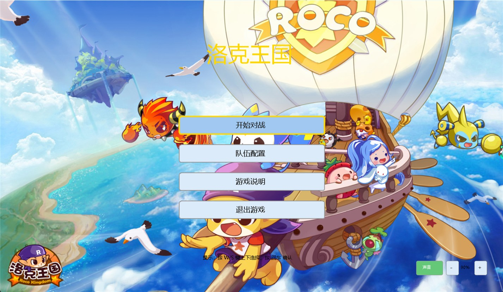
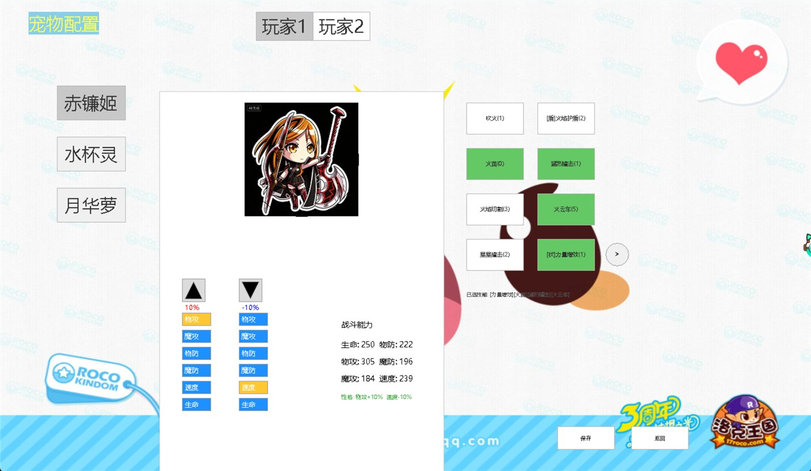
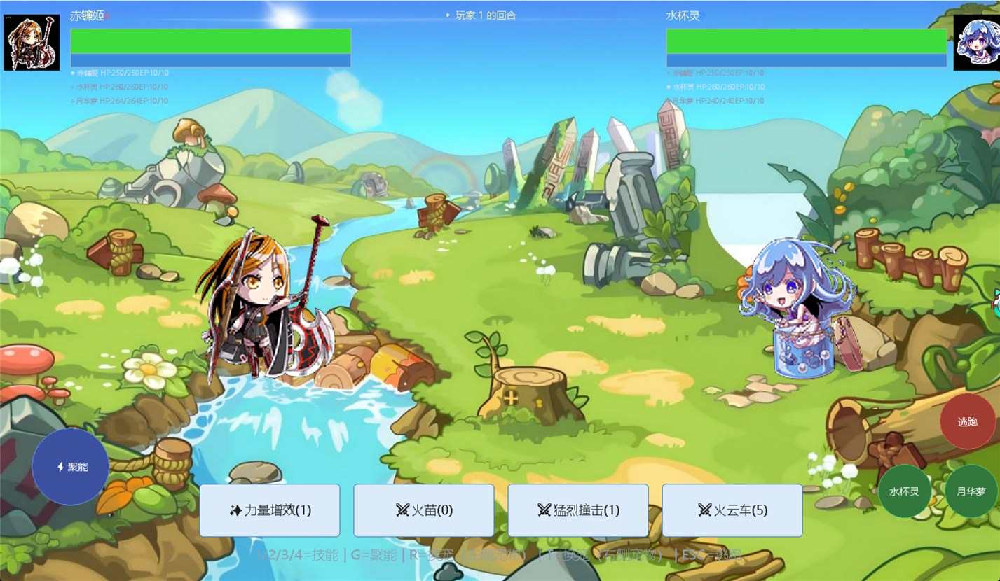
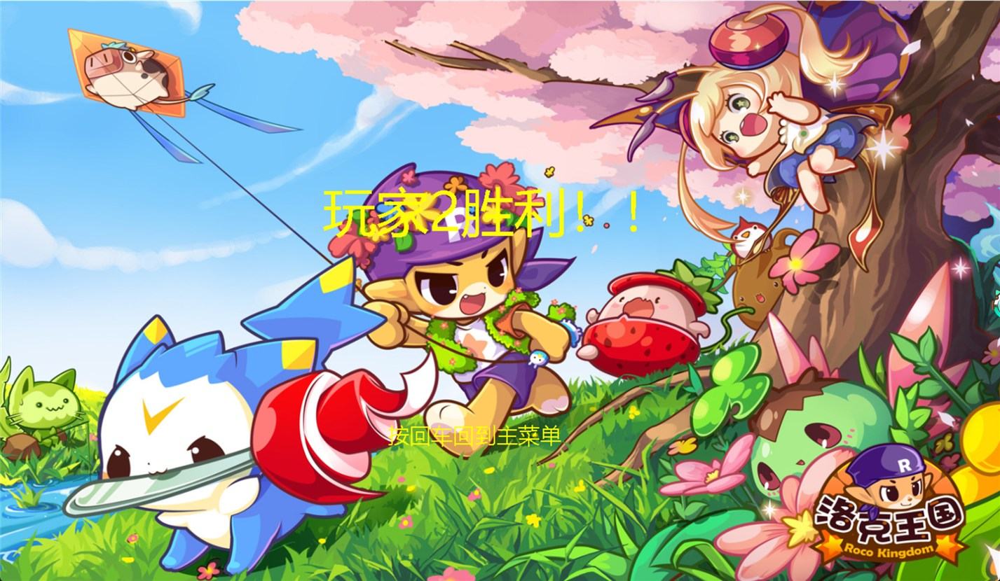
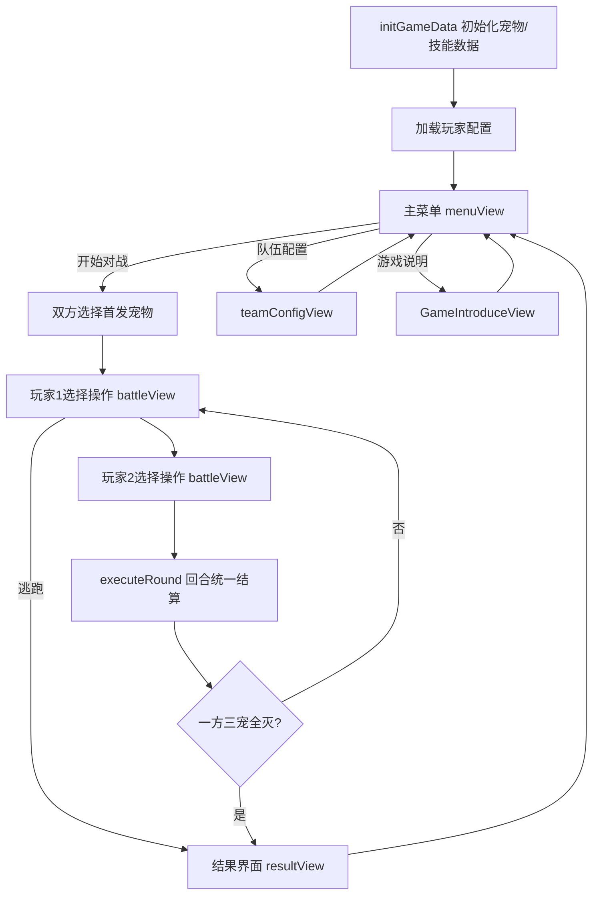

# 洛克王国 · RocoKingdom

> C++ / EasyX 实现的双人同屏回合制宠物对战游戏 —— 码力觉醒组课程项目

两位玩家在同一台电脑上轮流操作，各自指挥 3 只宠物。通过队伍配置（选择宠物、装备技能、搭配性格）组建阵容，在"盲选出招"的回合制对战中派出宠物、消耗能量、利用属性克制，击败对手全部宠物即获胜。

## 界面预览

| 主菜单 | 队伍配置 |
| :---- | :---: |
|  |  |
| **对战界面** | **结算界面** |
|  |  |

## 功能特性

- **主菜单**：开始对战 / 队伍配置 / 游戏说明 / 退出游戏四个入口，支持鼠标点击或 W/S + 回车操作，右下角可调节 BGM 音量（±10%）与静音
- **队伍配置**：切换玩家 1 / 玩家 2；为 3 只宠物分别从 9 个技能的技能池中装备 4 个（悬停可查看技能描述与威力）；六项属性任选一项 +10%、另一项 -10% 组成性格（也可保持平衡）；配置保存至 `player_save.json`
- **回合制对战**：双方隐藏出招（一方操作时另一方回避视线）、4 种指令（技能 / 聚能 / 换宠 / 逃跑）、速度决定先手、属性克制、防御减伤与冷却、宠物阵亡后替补上场、三宠全灭判负
- **战斗表现**：EasyX 绘制 1427×830 战斗界面；宠物精灵掩码贴图（双方朝向相反）、血条按剩余血量比例变色、能量条、状态文字、防御冷却提示，回合结算时显示过渡画面
- **音频**：基于 WinMM / MCI 播放 MP3，主菜单与对战 / 胜利使用不同 BGM，循环播放并绑定游戏窗口
- **数据**：宠物与技能数据库硬编码在 `GameData.cpp`；玩家配置以 JSON 持久化

## 玩法规则

### 对战流程

1. 玩家 1、玩家 2 先后选择首发宠物
2. 每回合双方依次选择操作，一方操作时另一方回避视线（"盲选"），双方选择完毕才统一结算
3. 任意一方 3 只宠物全部阵亡，或主动逃跑，则对方获胜

### 行动指令

| 指令 | 说明 |
| --- | --- |
| 释放技能 | 从 4 个技能槽中选择一个，需要支付对应能量 |
| 聚能 | 消耗一回合，为当前宠物回复 5 点能量（期间仍会被攻击） |
| 更换宠物 | 换上队伍中其他存活的宠物；被换下宠物的状态与属性增益清空 |
| 逃跑 | 二次确认后立即结束战斗，逃跑方判负 |

### 能量系统

- 每只宠物开局拥有 10 点能量，上限 10 点
- 技能消耗 0 ~ 5 点不等，能量不足时对应技能按钮置灰
- 部分技能附带回能效果（如「火苗」攻击后回复 1 点能量）

### 属性克制

| 攻击 ↓ / 防御 → | 火 | 水 | 草 |
| :---: | :---: | :---: | :---: |
| **火** | ×1 | ×0.5 | ×2 |
| **水** | ×2 | ×1 | ×0.5 |
| **草** | ×0.5 | ×2 | ×1 |

### 伤害与防御

- 基础伤害 = 技能威力 × 克制倍率 ×（攻击方攻击力 ÷ 防御方防御力），按整数截断；物攻技能取物攻 / 物防，魔攻技能取魔攻 / 魔防
- 攻击与防御在同一回合相遇时同时结算：防御方按防御技能的减伤率减免伤害（技能 `power` 即减伤百分比，如 80 点 power = 减伤 80%），减免后最低造成 1 点伤害
- 一次成功的防御之后，该玩家下一回合进入防御冷却，无法再次防御；能量不足导致防御失败时不产生冷却
- 部分技能附带额外效果：如「吹火」使用后物攻 +20%、「蔚蓝之风」速度 +20%、「力量增效」物攻 +100%、「祈雨」回复 50% 生命、「火焰护盾」防御时双防 +20%、「纤维化」防御时回复 20% 生命

### 宠物与性格

- 三只可选宠物：火系「赤镰姬」、水系「水杯灵」、草系「月华萝」，每只拥有 9 个技能可选（攻击 / 防御 / 状态三类）
- 性格影响六项属性（生命 / 物攻 / 物防 / 魔攻 / 魔防 / 速度）：一项 ×1.1，另一项 ×0.9，不可选择同一项
- 状态系统（灼烧：每回合按层数扣血、层数减半，界面上显示「灼烧xN」）已实现，当前技能数据中暂无施加灼烧的技能，可在 `GameData.cpp` 中自行配置

## 技术栈

| 类别 | 选型 |
| --- | --- |
| 语言标准 | C++20（Visual Studio `stdcpp20`） |
| 图形界面 | [EasyX](https://easyx.cn/)（`graphics.h`），窗口 1427×830 |
| 音频 | Windows Multimedia（`winmm.lib` + MCI）播放 MP3 |
| 数据存储 | [nlohmann/json](https://github.com/nlohmann/json)（`thirdlib/json/json.hpp`） |
| 构建 | Visual Studio 解决方案 `RocoKingdom.slnx`，MSVC v145 工具集，x64 |

## 项目架构

采用 Model / Service / View 三层结构，`main.cpp` 负责主循环与场景调度：



- **Model 层**（纯数据，不依赖图形库）：`type.h` 枚举（属性 / 技能类型 / 状态 / 操作 / 性格）、`Skill` 技能、`PetTemplate` 宠物品种模板（基础六维 + 技能池）、`Pet` 战斗实例（性格修正后属性、当前血量 / 能量、状态列表）、`Player` 玩家（3 只宠物 + 出战索引 + 防御冷却）、`Action` 回合操作、`StatusEffect` 状态效果
- **Service 层**（业务逻辑）：`GameData` 宠物与技能硬编码数据库、初始化、BGM 播放入口；`BattleService` 属性克制、伤害计算、回合结算（速度 / 换宠 / 防御 / 聚能 / 逃跑优先级）、状态结算、换宠与胜负判定；`DataService` JSON 存读档与性格属性修正
- **View 层**（界面）：`MainMenuScene`、`TeamConfigScene`、`PetChoiceScene`、`BattleScene`、`ResultScene`、`GameIntroduce`，以及通用的 `Button` 组件（悬停 / 按下 / 点击状态机）

## 构建与运行

### 环境要求

- Windows 10 / 11（EasyX 仅支持 Windows）
- Visual Studio 2022 及以上。项目使用 **v145** 工具集（随较新版本 Visual Studio 提供）；若使用 VS 2022，请在项目属性中将平台工具集改为本机已安装的版本（如 v143）
- [EasyX](https://easyx.cn/) 图形库，安装时选择对应的 Visual Studio 版本

### 编译

1. 用 Visual Studio 打开 `RocoKingdom/RocoKingdom.slnx`
2. 选择 `Debug | x64` 配置
3. 生成解决方案

### 运行

- 推荐在 Visual Studio 中直接运行：工作目录默认为项目目录 `RocoKingdom/RocoKingdom`，资源相对路径 `..\image`、`..\music`、`figure\` 可正确解析
- 若手动运行 `RocoKingdom/x64/Debug/RocoKingdom.exe`，需将其**工作目录**设置为 `RocoKingdom/RocoKingdom`，否则无法加载图片与音乐
- `player_save.json` 随仓库提供；若删除该文件，游戏仍可启动并使用默认配置，但队伍配置的保存会失败

### 操作说明

| 界面 | 操作 |
| --- | --- |
| 主菜单 | 鼠标点击，或 W / S 选择 + 回车确认 |
| 首发选择 | 鼠标点击卡片，或 1 / 2 / 3 切换 + 回车确认 |
| 对战 | 鼠标点击技能 / 聚能 / 换宠 / 逃跑按钮；或 1/2/3/4 = 技能、G = 聚能、R / T = 换宠、ESC = 逃跑 |

## 目录结构

```
Project1-Rocokingdom/
├─ README.md
├─ 可行性分析.txt                   可行性分析
├─ 需求文档最终.xlsx              需求文档
├─ 洛克王国流程图终版.excalidraw   流程图
├─ docs/screenshots/               README 截图
└─ RocoKingdom/                   Visual Studio 解决方案
   ├─ RocoKingdom.slnx
   ├─ RocoKingdom/                项目源码
   │  ├─ main.cpp                 游戏主循环与场景调度
   │  ├─ Model/                   数据模型
   │  ├─ Service/                 业务逻辑（GameData / BattleService / DataService）
   │  ├─ View/                    界面（6 个场景）
   │  ├─ *.cpp                    场景与业务实现
   │  ├─ Button.cpp / Button.h    按钮组件
   │  ├─ player_save.json         玩家配置存档
   │  ├─ figure/                  界面背景图
   │  ├─ thirdlib/json/           nlohmann/json 单头文件
   │  └─ x64/                     编译中间产物
   ├─ image/                      宠物素材（原图 / 掩码 / 头像 / 帧序列 / 对战背景）
   ├─ music/                      BGM 与音效（MP3）
   └─ x64/Debug/                  可执行文件输出
```

## 团队成员与分工

| 成员 | 负责模块 |
| :---: | --- |
| Andy | 数据模型（`Model` 层数据类）与主循环（`main.cpp`） |
| kumaxi | 主菜单 / 首发选择 / 结果 / 游戏说明界面，BGM 播放与音量控制 |
| Hermir | 回合结算核心（`executeRound` / `executeAction`） |
| 哈哈哈 | 伤害计算、属性克制、状态结算、换宠与胜负判定 |
| Naz | 玩家配置 JSON 存读档（`DataService`） |
| Prospect | 宠物 / 技能数据库与初始化（`GameData`） |
| 我 | 对战界面（`BattleScene`） |

> 队伍配置界面（`TeamConfigScene`）的负责人待补充。

## 项目文档

- [可行性分析](可行性分析.txt)
- [需求文档（最终）](需求文档最终.xlsx)
- [流程图（Excalidraw）](洛克王国流程图终版.excalidraw)

## 声明

本项目为课程学习与技术交流用途，仅用于非商业目的。《洛克王国》相关名称、宠物设定与美术素材版权归原权利方所有。
